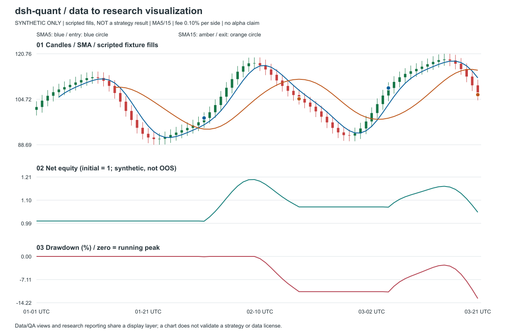

# Data to research visualization / synthetic only

```sh
npm ci
node --import tsx demos/data-visualization.ts
```

Open [example.svg](example.svg), inspect [example.json](example.json), or see
the raster preview below. No server, model, external renderer/data fetch or
new runtime dependency is required. The source is
[data-visualization.ts](../data-visualization.ts); output generation is deterministic.



Three views share a fixed80-point daily UTC fixture: OHLC/SMA/fill markers,
equity and underwater drawdown. SMA warmups stay null; gaps start a new path.
The core ChartData structures are reused, not replaced by a new model tool.

**Manually scripted fixture fills, NOT a strategy/backtest result.** The small
fixture ledger has independent round-trip oracles for winning, losing and flat
trades/fees. While plotting, a cash-reconciliation defect was reproduced in
the existing MA engine and tracked in [#166](https://github.com/pengpengyi92/dsh-quant/issues/166).
The engine remains unchanged/unfixed by this catalog contribution; its incorrect
equity is not published as verified strategy performance. No OOS/alpha claim.

Only the self-authored renderer was measured:20 warmups,250 renders of the same
80-bar model, observed mean0.1411ms,27486-byte SVG on Windows/Node24.18.0 at
2026-11-14T16:10:56+08:00. This excludes file IO/rasterization/browser work;
it is not a comparison against the12 catalogued libraries or a latency SLA.
PNG was rasterized for visual inspection using an already installed Sharp,
not added as a dependency. Regeneration requires rerasterizing the preview
separately; generated SVG/JSON are the tested deterministic artifacts.

[Methods and12 pinned reference repos](../../docs/data-visualization/README.md).
Charts help diagnose data and accounting, but do not make an invalid model valid.
